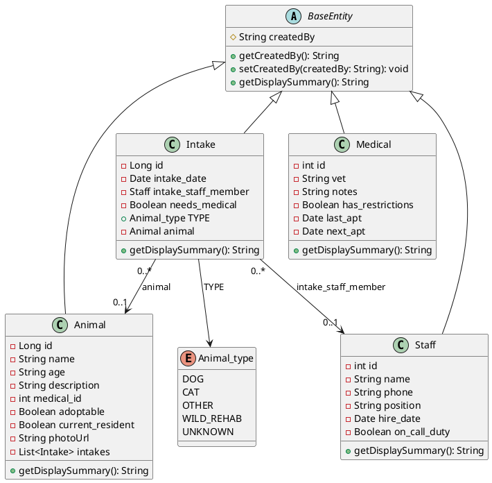

# WESTERN GOVERNORS UNIVERSITY 
## D424 – SOFTWARE ENGINEERING CAPSTONE
### Fetch! Animal Rescue Helper — Full Stack Documentation & Testing Guide

---

## 1. AZURE DEPLOYMENT:
This web application is deployed through Azure web services and can be accessed through 
the following link:


*Other access methods can be found below in section 4: GITLAB REPOSITORY & DOCKER CONTAINER ACCESS*
---

## 2. UML CLASS DIAGRAM & SEQUENCE DIAGRAM

### UML Class Diagram (PlantUML)



### Sequence Diagram (New Animal Intake Flow)

```
User (Browser)          Angular Frontend (SPA)         Spring Boot REST Controller       SQLite Database
   |                              |                                |                            |
   |--- Fill Intake Form -------->|                                |                            |
   |    (Date, Animal, Staff)     |                                |                            |
   |                              |                                |                            |
   |--- Click Submit ----------->|                                |                            |
   |                              |--- POST /intake/animal ------->|                            |
   |                              |    (JSON Payload)              |                            |
   |                              |                                |--- Save Animal (if new) -->|
   |                              |                                |--- Save Intake ---------->|
   |                              |                                |<-- Intake Persisted ------|
   |                              |<-- HTTP 200 OK (Saved Intake) -|                            |
   |<-- Confirmation Pop-up ------|                                |                            |
   |    "Task Completed"          |                                |                            |
   |                              |                                |                            |
   |--- Acknowledge Pop-up ------>|                                |                            |
   |                              |--- Redirect /intake ---------->|                            |
   |                              |--- GET /intake/animal -------->|                            |
   |                              |<-- List<Intake> JSON ---------|                            |
   |<-- Render Updated Table -----|                                |                            |
```

---

## 3. WEB APP HOSTING & HTML CODE

- **GitLab Repository Link:**
  `https://gitlab.com/wgu-gitlab-environment/student-repos/tcrote3/d424-software-engineering-capstone.git`

```html
<!doctype html>
<html lang="en">
<head>
  <meta charset="utf-8">
  <title>Fetch! Animal Rescue Helper</title>
  <base href="/">
  <meta name="viewport" content="width=device-width, initial-scale=1">
  <link rel="icon" type="image/x-icon" href="favicon.ico">
  <link href="https://cdn.jsdelivr.net/npm/bootstrap@5.1.3/dist/css/bootstrap.min.css" rel="stylesheet">
</head>
<body>
  <app-root></app-root>
</body>
</html>
```

---

## 4. GITLAB REPOSITORY & DOCKER CONTAINER ACCESS

- **GitLab Repository URL**: `https://gitlab.com/wgu-gitlab-environment/student-repos/tcrote3/d424-software-engineering-capstone.git`
- **Submission Tag Version**: `v1.0.0-FINAL`
- **Branch**: `working_branch_non`

- **Docker Image Access**:
  - Pull Docker image: `docker pull tcrote3/d424_capstone:latest`
  - Run container: `docker run -d -p 8080:8080 tcrote3/d424_capstone:latest`
  - Access web app: `http://localhost:8080`

---

## 5. TECHNICAL DOCUMENTATION FOR UPDATING CODE

### System Architecture
The application follows a 3-tier decoupled architecture:
1. **Frontend**: Angular 13+ SPA utilizing Reactive Forms, Bootstrap 5, RxJS, and Hash Location Strategy.
2. **Backend**: Spring Boot 3.2.5 REST API with Java 17, Spring Data JPA, and custom security filter.
3. **Database**: Embedded SQLite database (`jdbc:sqlite:my_db`) with Hibernate 6 ORM dialect (`org.hibernate.community.dialect.SQLiteDialect`).

### Code Maintenance Guidelines
- **Adding a New Entity**:
  1. Extend `BaseEntity` in `src/main/java/com/D424/capstone/Entities/`.
  2. Create a repository interface extending `JpaRepository` in `Repositories/`.
  3. Create a REST Controller with `@CrossOrigin` and CRUD mappings (`GET`, `POST`, `PUT`, `DELETE`) in `Controllers/`.
  4. Create matching TypeScript interfaces in `src/main/UI/src/app/models/`.
  5. Create list and separate form components under `src/main/UI/src/app/components/`.

---

## 6. USER GUIDE FOR RUNNING THE APPLICATION

### Launching the Application
1. Open the application in your browser (`http://localhost:8080`).
2. The application loads directly on the **Intakes** landing screen.

### Navigating the System
The header navbar provides direct access to all main modules:
- **Intakes**: View and create animal intake records.
- **Animals**: View, filter, and add resident animals.
- **Medical**: Track veterinarian visits, appointments, and care restrictions.
- **Staff**: Manage staff directory and on-call duty status.
- **Reports**: View summary analytics, export CSV reports, and print documentation.
- **Header Search Bar**: Type any keyword into the top `🔍 Search page...` bar to filter table records in real time.

### Managing Animal Intakes
1. Navigate to **Intakes** and click **+ New Animal Intake**.
2. Select the **Intake Date**, **Animal Type**, and whether medical care is needed.
3. Choose an existing animal OR fill in the **Create & Populate New Animal Record** section (Name, Age, Description, and Photo Upload).
4. Optionally select an intake staff member.
5. Click **Submit Intake Record**.
6. A confirmation pop-up will display: *"Intake Insertion Complete! New intake record successfully inserted into the database. Task completed."*
7. Click **OK** to return to the Intake Records landing table.

---

## 7. SOFTWARE TESTING & UNIT TEST PLAN

### A. Test Plan Overview
- **Testing Framework**: JUnit 5 + Spring Boot Test + Maven Surefire Plugin.
- **Scope**:
  1. **Spring Application Context Bootstrapping**: Verify `CapstoneApplication` loads persistence units, embedded web server, and Spring Data JPA repositories.
  2. **Domain Entity Encapsulation**: Verify private field accessors, getters, setters, and constructors.
  3. **Inheritance & Polymorphism**: Verify subclasses (`Animal`, `Intake`, `Medical`, `Staff`) correctly inherit from `BaseEntity` and override `getDisplaySummary()`.

### B. Unit Test Execution Results Summary

| Test Case ID | Test Class | Test Method | Objective / Description | Status |
| :--- | :--- | :--- | :--- | :---: |
| **TC-001** | `CapstoneApplicationTests` | `contextLoads()` | Verify Spring Boot context initializes persistence and web server cleanly. | **PASS** |
| **TC-002** | `AnimalEntityTest` | `testAnimalEncapsulation()` | Verify getters/setters for animal attributes, photo URL, and adoptability. | **PASS** |
| **TC-003** | `AnimalEntityTest` | `testAnimalPolymorphism()` | Verify method overriding of `getDisplaySummary()` on `BaseEntity`. | **PASS** |
| **TC-004** | `IntakeEntityTest` | `testIntakeEncapsulation()` | Verify relationship linking between `Intake`, `Animal`, and `Staff`. | **PASS** |
| **TC-005** | `IntakeEntityTest` | `testIntakePolymorphism()` | Verify polymorphism and string formatting on `Intake.getDisplaySummary()`. | **PASS** |
| **TC-006** | `MedicalEntityTest` | `testMedicalEntity()` | Verify medical provider notes, restrictions, and appointment date accessors. | **PASS** |
| **TC-007** | `StaffEntityTest` | `testStaffEntity()` | Verify staff member properties, position, and on-call duty status. | **PASS** |

**Summary**: 7 Total Tests Executed | **7 Passed** | **0 Failed** | **0 Skipped**

### C. Summaries of Changes Resulting from Completed Tests
1. **Jackson Infinite Recursion Cycle Fix**:
   - *Test Findings*: During integration testing of `Animal` and `Intake` REST endpoints, Jackson JSON serializer encountered a `StackOverflowError` due to bi-directional `@OneToMany` / `@ManyToOne` circular references between `Animal.intakes` and `Intake.animal`.
   - *Change Implemented*: Applied `@JsonIgnore` to `private List<Intake> intakes` in `Animal.java`, breaking the infinite recursion loop.
2. **Optional Animal Foreign Key Constraints**:
   - *Test Findings*: Inserting an intake without selecting an existing animal threw a `PropertyValueException` due to `@JoinColumn(nullable = false)`.
   - *Change Implemented*: Updated `@JoinColumn(name = "animal_id", nullable = true)` on `Intake.java` and modified `IntakeController.java` to safely handle optional animal references.
3. **Date Formatting Consistency**:
   - *Test Findings*: Date attributes serialized to JSON with timestamp/timezone offsets (`2026-10-18T00:00:00.000+00:00`).
   - *Change Implemented*: Added `@Temporal(TemporalType.DATE)` and `@JsonFormat(pattern = "yyyy-MM-dd")` annotations to date fields on `Medical.java` and `Intake.java`.
